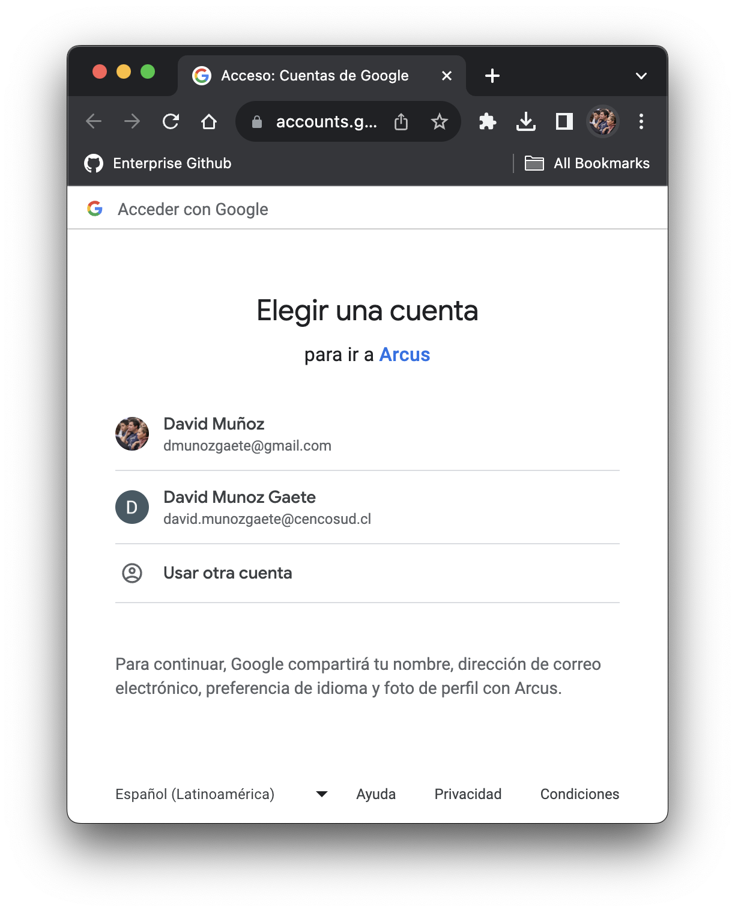

Proveedor de autenticación social de Google, que nos permite acceder a través de una cuenta personal o corporativa de Google via email.
<br />
<br />
Su uso y alcance principal se basa en cualquier contexto general donde se requiera identificar alguna identidad digital, la información obtenida es de contexto general.

Ejecución de ejemplo (_[Listado de Ambientes][1]_):

```shell
IAM_BASE_URL="https://api.staging.cencox.xyz/iam/api";
IAM_PROVIDER="google_gmail";

# App in you want to authenticate
APP_CLIENT_ID="social_app";

# Url where you want to redirection when process completed (with SUCCESS or FAIL)
APP_REDIRECTION_URI="${IAM_BASE_URL}/v1/oauth2/callback"

IAM_URL="${IAM_BASE_URL}/v1/oauth2/${APP_CLIENT_ID}/authorize/${IAM_PROVIDER}?redirect_uri=${APP_REDIRECTION_URI}&prompt=login&response_type=token" 

echo "${IAM_URL}";
open "${IAM_URL}"
```

Si todo marcha bien, lo que se deberia presentar a continuación será algo como lo mostrado a continuación:

<center>



</center>


La información de la cuenta digital se describe a continuación:


| Variable      | Descripción                           | Tipo              |
| ---           | ---                                   | ---               |
| primarysid    | Identificador del Proveedor (email)   | string (correo)   |
| unique_name   | Nombre del usuario                    | string            |
| email         | Email del usuario                     | string            |
| avatar        | Url de la imagen de la cuenta         | string            |

[1]: ./../../getting-started/environments.md